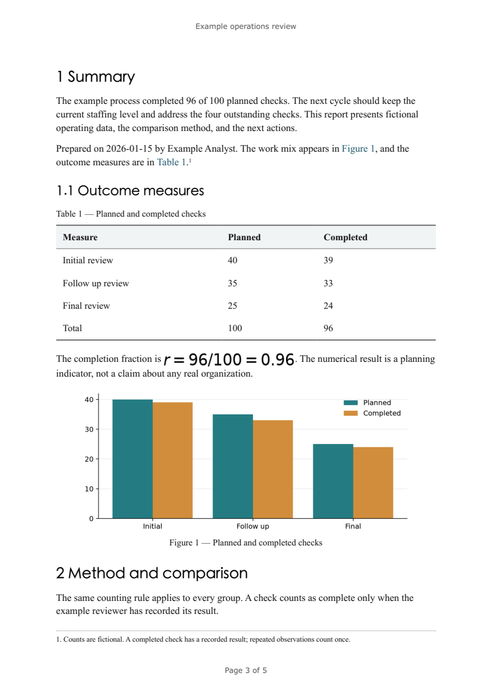

# md-report-builder

Build formal reports from local Markdown with one command. The same source produces
native Word documents, paginated PDFs, and self-contained HTML with a cover,
contents, numbered headings, tables, figures, equations, footnotes, and references.
No account, API key, Pandoc, or network service is required.



The [example source](examples/report.md) includes three tables, two chart blocks,
a fragment, a footnote, equations, task lists, and figure/table/section references.
Generated examples: [Word](examples/rendered/report.docx),
[PDF](examples/rendered/report.pdf), [HTML](examples/rendered/report.html).

## Install

Python 3.11 or newer is required. DOCX and HTML need no system renderer.

```sh
git clone https://github.com/GuoHaoyu1688/md-report-builder.git
cd md-report-builder
python3 -m venv .venv
. .venv/bin/activate
pip install -e .
```

For PDF on Ubuntu, install Pango and the open-source Noto CJK fonts. WeasyPrint
subsets and embeds the installed fonts in its PDF output.

```sh
sudo apt-get update
sudo apt-get install -y libpango-1.0-0 libpangoft2-1.0-0 fonts-noto-cjk
pip install -e '.[pdf]'
```

On macOS, install Pango with `brew install pango` and the Noto CJK fonts from the
[official Noto repository](https://github.com/notofonts/noto-cjk). If dynamic
libraries are not found, set `export MDR_LIBRARY_DIR="$(brew --prefix)/lib"`.
This explicit hint also works when a virtual environment's shell launcher strips
`DYLD_*` variables. No font or library is downloaded by `mdr`.

The default CJK families are Noto Serif CJK SC and Noto Sans CJK SC. Install them
on machines opening a DOCX for consistent appearance. A reference template can
instead select locally licensed Song, FangSong, Hei, or another installed font.
Missing fonts may be substituted by the document viewer; inspect the result.

## Quick start

After installation, these three commands build the included example:

```sh
mdr lint examples/report.md --json
mdr build examples/report.md --to docx --out data/reports --json
mdr build examples/report.md --to html --out data/reports --json
```

With the PDF extra and libraries installed:

```sh
mdr build examples/report.md --to pdf --out data/reports --json --progress
```

Outputs are `report.docx`, `report.html`, and `report.pdf` in the chosen directory.
Repeated builds atomically replace that source's output in that directory.
Longer builds send progress to stderr; stdout remains one JSON object.

## Four templates

| Template | Intended use | Heading numbers | Cover / contents |
| --- | --- | --- | --- |
| `business` | General business reports | `1`, `1.1`, `1.1.1` | Both |
| `gongwen` | Formal Chinese typography | `一、`, `（一）`, `1.`, `（1）` | Both |
| `tech` | Technical reports with compact code | Decimal | Both |
| `weekly` | Short weekly updates | None | Inline title / no contents |

`mdr templates --json` lists them. `--template` accepts a built-in name or a
local directory containing `style.yaml` and an optional `reference.docx`.
The reference contributes styles and section settings; its body is cleared.
See [template settings](docs/format.md#templates) for fonts, named sizes such as
`小四`, spacing, margins, and numbering. Front matter can override numbering,
cover, and contents. CLI template selection takes precedence over front matter.

## Source format

```yaml
---
title: Example operations review
subtitle: Capacity results and next cycle actions
author: Example Analyst
date: 2026-01-15
classification: Example document
template: business
numbering: technical
cover: true
toc: true
language: en
---
```

Author can be empty. Dates default to the current date in Asia/Shanghai.
`language: zh` enables Chinese figure/table labels and the Word page footer
`第 X 页 共 Y 页`. The tool and documentation remain English.

A directory input merges its top-level `.md` files in filename order. The first
front-matter value for each key wins. `!include fragments/section.md` expands a
local Markdown fragment relative to its containing file. Images resolve there
as well. Cycles, excessive depth, oversized sources, and resources escaping the
source root are rejected. `{{date}}`, `{{author}}`, and scalar metadata variables
are expanded; unknown variables are retained with warnings.

Supported content includes headings, emphasis, links, three-line tables with
repeated headers, raster images, quotations, code, lists, tasks, and footnotes.
Markdown HTML is escaped. Local images are embedded; remote images are rejected.
See [the full format](docs/format.md) for precise syntax and bounds.

### Figures, tables, and references

```md
# Summary {#summary}


Table: Example totals {#totals}

| Group | Count |
| --- | --- |
| A | 4 |

See [@fig:chart], [@tbl:totals], and [@sec:summary].
```

Captions are numbered automatically. DOCX uses `SEQ`/`REF` fields and bookmarks,
with cached visible results. Heading prefixes are computed at build time; rebuild
after changing Markdown. Word's contents and page fields update in a supporting
editor; the initial contents also includes usable cached links. PDF contents
contains page numbers and clickable links immediately.

### Charts and equations

A `chart` fence accepts YAML with `type: bar|line|pie`, `x` labels, and `y` values
or named `series`. It can also contain CSV with labels in the first column and
numeric series in later columns. Matplotlib renders charts locally. Example:

````md
```chart
type: bar
id: progress
title: Example completed checks
x: [First, Second, Third]
y: [82, 89, 96]
```
````

Inline `$x^2$` and block `$$...$$` equations use Matplotlib MathText and are
embedded as sharp PNGs in all outputs. This supports common fractions, sums,
symbols, and superscripts; it is not a full TeX engine and does not produce
editable Word equations. Unsupported math returns a structured error.
`mermaid` fences are preserved as code with an explicit warning.

## CLI reference

| Command | Purpose |
| --- | --- |
| `mdr build INPUT --to docx\|pdf\|html --template NAME --out DIR [--strict]` | Build from a file or sorted directory |
| `mdr lint INPUT` | Check heading jumps, empty links, missing images, uneven table rows |
| `mdr templates` | List built-in templates |
| `mdr history` | List recorded builds |
| `mdr export --format json\|csv --out FILE [--no-bom]` | Export history |
| `mdr import FILE` | Validate and import a history snapshot; skip existing IDs |
| `mdr backup [--out DIR]` | Create a dated ZIP of SQLite history |
| `mdr clear-history --yes` | Delete history rows; leave reports and sources intact |
| `mdr mcp` | Start the stdio MCP server |

Globals can appear before or after the command: `--data-dir`, `--config`,
`--json`, `--quiet`, `--progress`, `--version`. JSON is the default.
The data directory precedence is CLI, `MDR_DATA_DIR`, TOML config, `./data`.
The default database is `data/cache.sqlite`, reports `data/reports/`, backups
`data/backups/`. Example TOML is in [examples/config.toml](examples/config.toml).

All commands return `{"ok":true,"data":...,"warnings":[]}` on success. Errors
return `{"ok":false,"error":{"code":"...","message":"..."}}`. Exit codes:
0 success; 1 operational error; 2 invalid input or lint findings; 3 missing input
or optional dependency. Lint findings retain an `ok:true` result with `valid:false`
and exit 2 so callers can inspect every diagnostic.

History records output paths, hashes, counts, template, and build time; it does
not contain source text. A rerun of the same source content/metadata, output path,
format, and template updates its existing row. History exports and backups do
**not** back up Markdown, images, custom templates, or generated reports. Copy
those files separately before overwriting them. CSV exports use UTF-8 BOM by
default; all other text is UTF-8.

## Python and MCP

```python
from md_report_builder import build

result = build("examples/report.md", "docx", "business", "data/reports")
print(result["output"])
```

The Python API does not record history unless `data_dir=` is supplied. CLI and
MCP call the same core. MCP uses the official Python SDK and exposes
`build_report`, `list_templates`, and `lint_markdown`:

```json
{
  "mcpServers": {
    "reports": {
      "command": "mdr",
      "args": ["--data-dir", "/workspace/data/md-report-builder", "mcp"]
    }
  }
}
```

See [AGENTS.md](AGENTS.md) for exact Linux setup, all commands, error handling,
MCP schemas, and operational recipes. Generated schemas are in
[docs/mcp-tools.json](docs/mcp-tools.json).

## Verification

```sh
pip install -e '.[dev,pdf]'
ruff check .
ruff format --check .
pytest -q --cov=md_report_builder
```

CI installs Pango and `fonts-noto-cjk` and tests Python 3.11 and 3.12. Tests reopen
all four templates' DOCX files, check exact source table values, figure numbers,
reference/TOC fields, header/footer, true footnote parts, and embedded images.
They build all four PDFs and inspect text, outlines, links, and page content.
Other tests cover Unicode, offline behavior, path restrictions, lint fixtures,
atomic output, JSON/CSV/backup roundtrips, CLI and all three MCP tools. The sample
Word and PDF documents were also rendered and visually inspected page by page.

## FAQ and roadmap

**Can I use arbitrary Markdown or HTML?** CommonMark plus tables, footnotes,
MathText and the documented extensions is supported. Raw HTML is escaped.
Complex footnote formatting is flattened in DOCX. Raster PNG/JPEG/GIF/WebP images
are supported; SVG and remote images are not. Included image paths should use
simple Markdown inline image syntax without spaces in the target.

**Will all Word viewers paginate identically?** No. Font availability and layout
engines affect page breaks. Word contents/page fields may need an update. PDF
uses WeasyPrint's independent HTML layout rather than Word pagination.

**Does gongwen guarantee a formal filing standard?** It provides configurable
Chinese font sizes and numbering, not certification for a particular authority.
Confirm the requested font, margins, spacing, and template before issuing a report.

**Can it render Mermaid or use LibreOffice for PDF?** Mermaid currently remains
visible source code. PDF uses WeasyPrint; a LibreOffice export adapter, editable
math, stronger nested-list fidelity, font diagnostics, and a watch command are
roadmap items. Pandoc is neither needed nor invoked.

MIT licensed. See [LICENSE](LICENSE) and [CHANGELOG.md](CHANGELOG.md).
